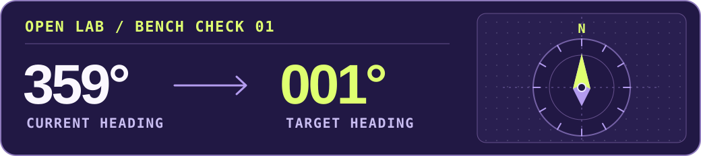

# Yohanes Anthony Saputra

## Hey, I’m Anthony 👋

I study Information Technology at **Universitas Gadjah Mada** in Yogyakarta. I build web and Android apps, write ESP32 firmware, and teach on campus. My favorite part is following a sensor reading all the way from the serial monitor to a screen someone can use.

[Campus life](#around-campus) · [Try the bench check](#bench-check) · [GitHub activity](https://github.com/AnthonyS051105#js-contribution-activity)

## Around campus

- **[Gamaforce](https://gamaforce.wg.ugm.ac.id/khageswara/khageswara-ground-control-station-2024/)** · I write firmware for a UAV ground station. I use GPS and orientation readings to steer the antenna in yaw and pitch.
- **Night Login Web Development Community** · I teach web development and mentor members as they build their own web projects.
- **[KMTETI Workshop](https://kmteti.org/divisi/workshop)** · I teach Arduino and ESP32 and work on the workshop registration site. At DTETI Open House, I ran a session on building a portfolio page for high school students.

💬 **Ask me about** debugging an ESP32 sensor, getting MQTT readings into an app, or wiring your first Arduino circuit.

## Bench check

An antenna tracker is pointing at **359°** and the target is at **1°**. What’s the shortest turn?

Reveal the answer

**2° clockwise, through north.** A direct subtraction gives −358°. Wrap that difference into the range from −180° up to 180°, and the result is +2°. That’s the heading correction you want before deciding what to tell the motor.

## Tools I reach for

**Web & APIs** · `TypeScript` `React` `Next.js` `Flask` `FastAPI`  
**Android** · `Kotlin` `Jetpack Compose`  
**Embedded & IoT** · `C++` `ESP32` `FreeRTOS` `MQTT`  
**Computer vision** · `Python` `PyTorch` `OpenCV`

## Milestones

- **[KRTI 2025](https://ugm.ac.id/en/news/gamaforce-ugm-wins-8th-overall-title-at-indonesias-flying-robot-contest-2025/)** · Overall Champion with the Gamaforce team.
- **Bootcamp TETI 2026** · 1st place in Mobile Development with GreenHouse+.
- **GEMASTIK XIX** · Finalist in Smart Devices, Embedded Systems, and IoT with PNEUMACARE.

## Selected repositories

- **PNEUMACARE** · Wearable respiratory monitoring prototype. [Software](https://github.com/AnthonyS051105/pneumacare-software) · [Firmware](https://github.com/AnthonyS051105/pneumacare-hardware)
- **UNSTOPPABLE** · A route planner for older adults. [Source](https://github.com/AnthonyS051105/unstoppable) · [Try the demo](https://unstoppable-mu.vercel.app)
- **GreenHouse+** · Greenhouse monitoring and control. [Android app](https://github.com/AnthonyS051105/smart-greenhouse-mobile) · [Firmware](https://github.com/AnthonyS051105/smart-greenhouse-iot)
- **NETRA** · Road damage detection and depth estimation. [Computer vision pipeline](https://github.com/AnthonyS051105/pothole-detector)

[Browse all repositories](https://github.com/AnthonyS051105?tab=repositories)
