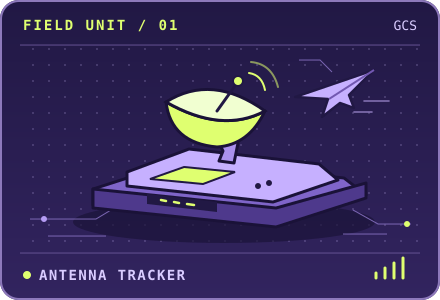
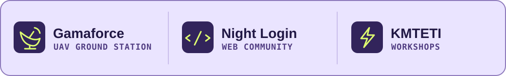
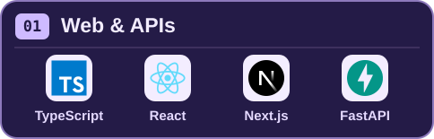
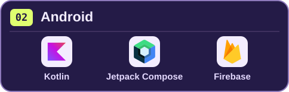
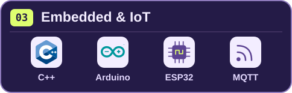
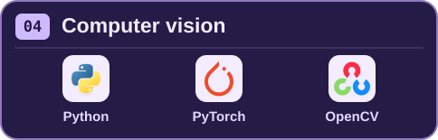

<h1 align="center">Yohanes Anthony Saputra</h1>

<p align="center">
  
</p>

<p align="center">
  
</p>

<p align="center">
  <a href="https://anthony-saputra.vercel.app/"></a>
  &nbsp;
  <a href="https://github.com/AnthonyS051105?tab=repositories"></a>
</p>

## About me 👋

I’m Anthony, an Information Technology student at **Universitas Gadjah Mada** in Yogyakarta. I like working on both ends of a system, from the ESP32 collecting a reading to the web or Android screen someone uses to make sense of it. I also teach Arduino and web development on campus.

<table>
<tr>
<td width="50%" valign="middle">

```ts
const anthony = {
  base: "Yogyakarta",
  campus: "UGM",
  build: [
    "Web & Android",
    "Embedded & IoT",
    "Computer vision",
  ],
  also: "Teaching",
};
```

</td>
<td width="50%" align="center" valign="middle">
  
</td>
</tr>
</table>

**Ask me about** bringing ESP32 readings into an app, debugging a sensor, or helping someone wire their first Arduino circuit.

## Around campus 🛰️



- **[Gamaforce](https://gamaforce.wg.ugm.ac.id/khageswara/khageswara-ground-control-station-2024/)** · I work on firmware for a UAV ground station. The antenna tracker uses GPS and orientation readings to steer in yaw and pitch.
- **Night Login Web Development Community** · I teach web development and mentor members as they build their own projects.
- **[KMTETI Workshop](https://kmteti.org/divisi/workshop)** · I teach Arduino and ESP32 and work on the workshop registration site. At DTETI Open House, I taught high school students how to build a portfolio page.

<details>
<summary><b>Try a bench check</b> · The antenna is at 359° and the target is at 1°. Which way should it turn?</summary>


**2° clockwise, through north.** A direct subtraction gives −358°. Wrap the difference into [−180°, 180°) before mapping the correction to a servo command.

</details>

## Tech stack 🧰

<p align="center">
  
  
  
  
</p>

## GitHub telemetry 📡

[](https://github.com/AnthonyS051105#js-contribution-activity)

[View my contribution history on GitHub](https://github.com/AnthonyS051105#js-contribution-activity)

## Selected work

| Project | What I worked on | Explore |
| --- | --- | --- |
| **PNEUMACARE** | ESP32 firmware and web software for a wearable respiratory monitoring prototype. | [Software](https://github.com/AnthonyS051105/pneumacare-software) · [Firmware](https://github.com/AnthonyS051105/pneumacare-hardware) |
| **UNSTOPPABLE** | Project coordination and frontend development for a route planner for older adults. | [Source](https://github.com/AnthonyS051105/unstoppable) · [Demo](https://unstoppable-mu.vercel.app) |
| **GreenHouse+** | Firmware, backend, and Android screens for greenhouse monitoring and control. | [Android](https://github.com/AnthonyS051105/smart-greenhouse-mobile) · [Firmware](https://github.com/AnthonyS051105/smart-greenhouse-iot) |
| **NETRA** | A computer vision pipeline for road damage detection and depth estimation. | [Source](https://github.com/AnthonyS051105/pothole-detector) |

**Milestones** · [KRTI 2025 overall champion with Gamaforce](https://ugm.ac.id/en/news/gamaforce-ugm-wins-8th-overall-title-at-indonesias-flying-robot-contest-2025/) · Bootcamp TETI 2026 Mobile Development winner with GreenHouse+ · GEMASTIK XIX finalist with PNEUMACARE

---

<p align="center">
  <sub>Thanks for stopping by Open Lab.</sub>
  <br />
  <a href="https://anthony-saputra.vercel.app/">Portfolio</a> · <a href="https://github.com/AnthonyS051105?tab=repositories">Repositories</a>
</p>
